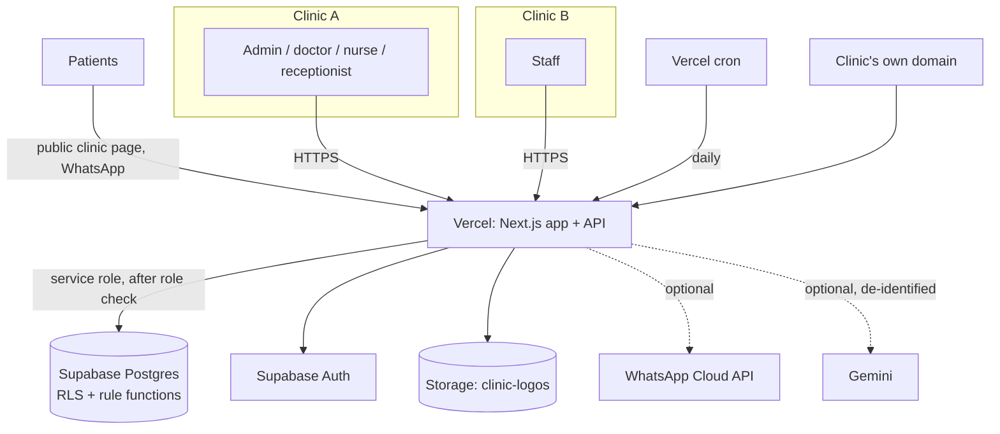
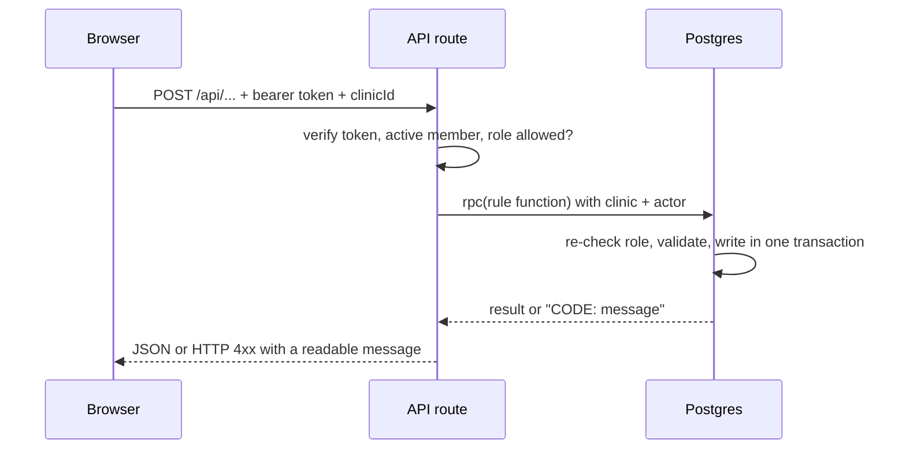

# High-level design

## 1. Context

One deployment, many clinics. A clinic's staff, branding, domain, AI name, builder objects and data are theirs alone.

## 2. Modules

| Module | Purpose | Main tables | Detailed design |
|---|---|---|---|
| Accounts & tenancy | Sign-up creates clinic + admin; login; roles | clinics, clinic_staff | MODULES §1 |
| Branding, domain, AI name | Logo, colour, tagline, web address, custom domain, bot name | clinics | §2 |
| Users | Who has a login; admin-only delete | clinic_staff, user_removals | §3 |
| Staff & doctors | Invite staff, doctor profiles, weekly hours | clinic_staff, doctors, doctor_schedules | §4 |
| Appointments & calendar | Slot-checked booking, reschedule, status, WhatsApp | appointments, doctor_leaves | §5 |
| Treatments | Multi-sitting plans, stock deduction, part payments | treatment_* , price_list | §6 |
| Billing | Invoices, payments, printable | invoices, doc_counters | §7 |
| Stock & purchasing | Items, suppliers, purchase orders, receipts, bills | stock_items, stock_movements, purchase_* , supplier_* | §8 |
| Attendance & leave | Check-in/out, corrections, leave balance, approvals | attendance, staff_leaves | §9 |
| AI Assistant | Chat to book/cancel/move and ask about the clinic | ai_questionnaire | §10 |
| AI Builder | Describe apps/tables/fields; approve; undo; access; reports | builder_* , permission_* , saved_* | §11 |
| AI trust layer | Gateway, scope, redaction, encryption, retention | ai_* | SECURITY.md |

## 3. Data handling

| Data | Where | Who sees it | Retention |
|---|---|---|---|
| Patients, appointments, invoices, stock | Postgres rows with `clinic_id` | That clinic's staff, by role | Until the clinic deletes; kept when a staff member is removed |
| Staff logins | Supabase Auth + `clinic_staff` | Admin sees the list (email, role, last sign-in) | Membership removed on delete; history kept |
| Logos | Public bucket `clinic-logos` (PNG/JPG/WebP ≤ 1 MB) | Anyone with the URL (intended: shown on public page) | Replaced/removed by admin |
| AI questions/answers | `ai_questionnaire`, encrypted | Author; admin | Admin-set days; deletable any time |
| What is sent to an AI provider | Nothing by default; de-identified text only if admin enables | Provider (stateless call) | Provider terms |
| Passwords | Supabase Auth (hashed) | Nobody | — |
| Secrets | Vercel env vars | Server only | Rotated on suspicion |

## 4. Typical request flow

## 5. Performance

- Shell (sidebar, clinic, role) is cached per tab so moving between screens does not reload it.
- Heavy rules are one database round trip.
- Indexes on `(clinic_id, date)` style keys; browser tests assert load and typing budgets (`tests/e2e/performance.spec.ts`).

## 6. Deployment & operations

See `HOSTING.md` (set-up, DNS, env vars), `TESTING.md` (how to run everything), and the runbook below.

**Runbook**

| Situation | Action |
|---|---|
| Health check | `GET /api/health` → `ok: true`, every migration `true` |
| A screen says a feature "is not installed yet" | Run the named migration in the Supabase SQL editor |
| User lost access | Admin → Users; or run `supabase/repair_restore_admin.sql` for the owner |
| Suspected key leak | Rotate in Supabase / Google, update Vercel env var, redeploy |
| Clinic wants AI history gone | Settings → AI & privacy → Delete all stored questions |
| Bad builder change | AI Builder → History → Undo |
| Roll back a deploy | Vercel → Deployments → promote the previous one (migrations are additive) |
