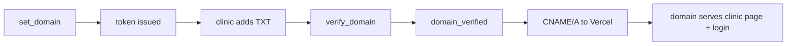
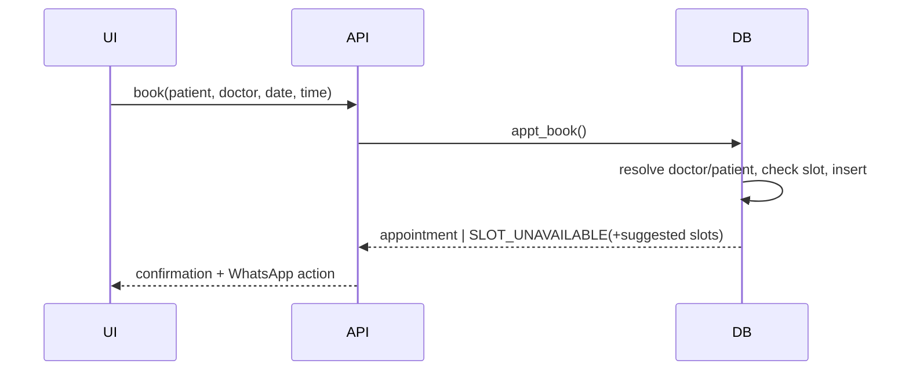
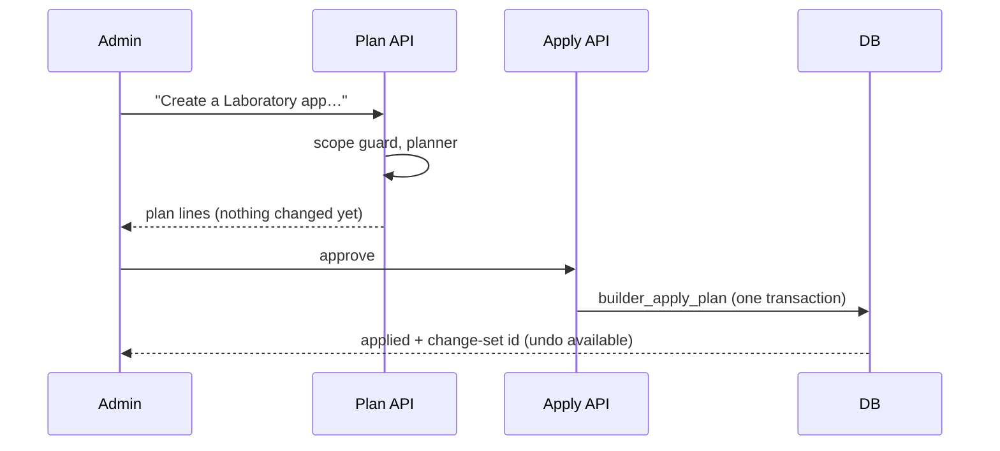

# Module design (HLD + LLD)

Each section: purpose, screens/APIs, rules (enforced in the database unless stated), data, flow.

## 1. Accounts & tenancy
- **Screens/API:** `/signup`, `/login`, `/reset-password`, `POST /api/clinic/create`, `/api/auth/resend`.
- **Rules:** sign-up validates brand/domain/AI name first, so a bad logo never leaves a half-created account; creates clinic, admin membership and defaults (`clinic_provision`: price list, treatment templates, leave types). A signed-in user picks the active clinic; every API call carries `clinicId` and is checked against `clinic_staff` (active, role).
- **Data:** `clinics`, `clinic_staff(clinic_id,user_id,role,is_active)`.
```mermaid
sequenceDiagram
  Browser->>/api/clinic/create: clinic, admin, brand
  /api/clinic/create->>Auth: create user (confirmation email)
  /api/clinic/create->>DB: insert clinic, admin staff, clinic_provision()
  DB-->>Browser: clinic ready; confirm email → login → dashboard
```

## 2. Branding, domain, AI name
- **Screens/API:** Settings → Branding card; `GET/POST /api/clinic/branding`; public `/c/<slug>`, `GET /api/public/clinic`; `src/middleware.ts`.
- **Rules:** colour `#rrggbb`; slug 3–38 chars, unique; AI name 2–24 chars; logo magic-byte checked, SVG refused; custom domain proven by TXT `_mediflow.<domain>` token, then pointed (CNAME/A) at Vercel; optional Vercel Domains API adds it automatically.
- **Theme:** `applyBrand()` rewrites the `--sky-*` variables (shade 600 forced to ≥ 4.5:1 contrast with white); `applyIdentity()` sets tab title and icon. Applied in the app shell, login, and public page.


## 3. Users (admin-only delete)
- **Screen/API:** `/users`; `GET /api/users` (any member sees the clinic's users), `DELETE /api/users` (admin only).
- **Rules (`users_remove`, migration 011):** caller must be an active admin of that clinic; cannot delete yourself; a clinic keeps at least one admin; membership row removed, doctor profile unlinked and deactivated, removal audited in `user_removals`. Appointments, invoices, attendance and leave stay on record. The login itself is not erased (other clinics may use it).
- **Test:** `supabase/tests/users_test.sql`.

## 4. Staff & doctors
- **Screens/API:** `/staff`, `/availability`, `POST /api/staff/invite`, `/api/doctors/availability`.
- **Rules:** admin only; doctor can be added without email (bookable, no login); an existing admin's role is never changed by an invite; hours need start < end and breaks inside the shift (`appt_set_schedule`).

## 5. Appointments & calendar
- **Screens/API:** `/appointments`, `/calendar`; `/api/appointments/{book,slots,reschedule,status,notify}`.
- **Rules:** `appt_check_slot` rejects double-booking, leave days, times outside hours/breaks; patient found by phone or created; doctor resolved by name; status changes (confirmed/cancelled/completed/no_show); timezone per clinic; WhatsApp message prepared as a link or sent via Cloud API when configured.


## 6. Treatments
- **Screens/API:** `/treatments`; `/api/treatments/{create,complete,pay}`.
- **Rules:** a template (e.g. root canal, 3 sittings) becomes a plan with dated appointments; sittings complete in order (`ORDER`); completing deducts the template's stock; dues add up to total − discount; part payments move the balance; invoice marked paid when cleared.

## 7. Billing
- **Screens:** `/billing`, `/billing/print`. **Rules:** per-clinic invoice numbers (`doc_counters`), status draft/sent/paid/partially_paid/cancelled, `bill_pay` records payments atomically; interns read but cannot change.

## 8. Stock & purchasing
- **Screens/API:** `/stock`, `/purchasing`, `/purchasing/print`, `/api/purchasing/{supplier,order,bill}`.
- **Rules:** low-stock = quantity ≤ minimum; `po_create`→`po_receive` adds stock and a `stock_movements` row; `po_cancel`; supplier bills and payments tracked; quantities never negative.

## 9. Attendance & leave
- **Screens/API:** `/attendance`, `/leave`; `/api/attendance`, `/api/leave`.
- **Rules:** one open check-in at a time; admin corrections audited; leave types with balances (`leave_balance`), requests overlap-checked, admin approves/rejects (`leave_decide`); a person sees their own, the admin sees all.

## 10. AI Assistant
- **Screen/API:** `/chatbot`, `POST /api/chatbot`, `/api/ai/{history,settings,purge}`.
- **Flow:** scope guard → intent parse (book / cancel / reschedule / add doctor / question) → booking engine, or `answerLocally` → optional gateway → log to `ai_questionnaire` → reply. A half-finished request (a booking missing the time) is carried as a `draft`.
- **Bot name** comes from `clinics.ai_name`; the page shows what is remembered and lets the user delete it.

### Division of work: assistant vs Builder
| | Assistant (`/chatbot`, everyone, within their role) | AI Builder (`/builder`, admin) |
|---|---|---|
| Calendar | agenda, free times, leave add/remove, weekly hours (admin), book, cancel, move, mark done / no-show (`src/lib/assistant/calendar.ts`) | booking rule: doctor choice, slot length |
| Records | add / update / list records of any table, saved as the caller so access rules apply (`records.ts`) | new tables, fields, apps, tabs |
| Reports | ad-hoc "show X by Y", create reports and dashboards via `assistant_apply` (`reports.ts`) | permission sets |
| Automation | none | flows: trigger (booked, cancelled, completed, no-show, invoice paid, record saved, stock low, day before, daily) → WhatsApp or task |
Open requests continue through a draft whose `intent` starts with `ax:`; every change asks for "yes" first.

**Flows engine:** DB triggers queue `flow_events` only when an active flow exists; `src/lib/flows/engine.ts` claims and runs them right after the action; `/api/flows/run` (daily cron) handles scheduled flows with per-day dedup. **Dashboard:** `dashboard_stats` (migration 012) computes collected vs billed, dues, utilisation, no-show rate, 7-day trend, doctor load and low stock.

## 11. AI Builder
- **Screens/API:** `/builder` (chat), `/builder/{data,access,reports}`, `/api/builder/{plan,apply,rollback,schema,data,access,reports}`.
- **Flow:** prompt → scope guard → planner (rules; or gateway when allowed) → **plan shown for approval** → `builder_apply_plan` applies everything in one transaction and records a change set → undo via `builder_rollback` (anything holding data is archived/hidden, never dropped).
- **Access:** admin sees everything; others see custom objects only through permission sets (read/create/edit/delete, all or own records). Reports run through `builder_query`, which honours the same access; reports and dashboards can be saved.
- **Data:** each clinic's objects are real tables created by `tenant_data`, with tenant guard triggers.


## 12. Demo trail
`/demo` serves the guided tour from `public/demo/index.html` for sales walkthroughs without touching real data.
