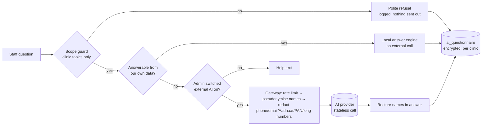

# Security layers and the AI trust layer

## 1. Layers that protect clinic data

| # | Layer | What it does | Where |
|---|---|---|---|
| 1 | Transport | HTTPS everywhere (Vercel, Supabase); `X-Content-Type-Options`, `X-Frame-Options`, `Referrer-Policy`, `Permissions-Policy` headers; `X-Powered-By` removed | `next.config.mjs` |
| 2 | Identity | Supabase Auth: email + password, mandatory email confirmation, password reset, invited staff set their own password | Supabase, `/api/staff/invite` |
| 3 | API gate | Every route verifies the bearer token and that the caller is an **active member of that clinic with an allowed role** | `requireClinicMember` |
| 4 | Role rules | admin / doctor / nurse / receptionist / intern each limited by route and by database policy; only an admin manages staff, branding, AI settings and **deletes users** | routes, `is_clinic_role` |
| 5 | Row-level security | Browsers can only read rows of their own clinic; writes on sensitive tables are not granted to browsers at all | `001`–`008` |
| 6 | Business-rule functions | `SECURITY DEFINER`, fixed `search_path`, executable only by the service role, re-check clinic and role | all `appt_*`, `tx_*`, `po_*`, `att_*`, `leave_*`, `builder_*`, `users_remove` |
| 7 | Tenant guards | Triggers and composite foreign keys refuse a record that points at another clinic's patient, doctor or object | `tenant_guard`, `tenant_same_clinic` |
| 8 | Builder access control | Custom objects are invisible to everyone except admin until a permission set grants read/create/edit/delete, optionally "own records only" | `008` |
| 9 | Input validation | Lengths, formats, enums, magic-byte check on logos (SVG refused), 10-digit phones, safe slugs and domains | routes, `branding.ts` |
| 10 | Secrets | Service-role key, AI key, `AI_DATA_KEY`, `CRON_SECRET` live only in Vercel env vars; a test fails the build if a key is hard-coded | `architecture.test.ts` |
| 11 | Audit | Builder change history with undo; `user_removals` (who removed whom); AI questionnaire; per-clinic numbering | tables |
| 12 | Backups & residency | Supabase daily backups; choose the Mumbai region for India-resident data | Supabase |

Guards against common mistakes: a clinic can never lose its last admin, an admin cannot delete their own account in the Users screen, and a staff invite can never demote an existing admin.

## 2. AI trust layer

**Promise:** what a clinic types to the assistant or the builder is stored only in that clinic's own database rows, is never visible to other clinics, and disappears from the AI when the clinic deletes it.

| Control | Behaviour |
|---|---|
| Scope guard | Only clinic and software questions are answered. Sports, news, entertainment, weather, politics, markets, coding, general knowledge and "ignore your rules" are refused **before** any lookup or external call; the gateway re-checks, and the model is told to answer `OUT_OF_SCOPE` otherwise |
| External AI off by default | A clinic admin must switch it on (Settings → AI & privacy). Until then the assistant answers appointments, revenue, unpaid invoices, low stock and patient counts from our own data and the builder uses built-in rules |
| De-identification | Patient and staff names become "Patient A"; emails, Aadhaar, PAN, phone and 9–18 digit numbers are removed before sending. The provider never sees the real names; the answer is mapped back locally |
| Rate limit | 20 AI calls per user per minute |
| Questionnaire table | Every question and answer is a row in `ai_questionnaire` (clinic, user, session, module, source). This is the **only** conversation memory: history is replayed from it on each turn |
| Encryption | Question and answer text is AES-256-GCM encrypted with `AI_DATA_KEY` before it is stored |
| Visibility | A user sees their own history; only the clinic admin can list the clinic's. Other clinics see nothing (RLS + service-role-only functions) |
| Deletion | "What the assistant remembers about you" panel: delete one, a session, or all of mine. Admin: delete all clinic history. Deleting the row removes it from the assistant's memory immediately |
| Retention | Admin sets days to keep (0 = keep nothing). A daily cron (`/api/ai/purge`, `CRON_SECRET`) deletes expired rows |

**Honest limits.** When external AI is on, the de-identified text does pass through the AI provider's servers to produce an answer; the provider's own retention is governed by its terms. That is why it is optional, off by default, and de-identified. We cannot control what a user types that is not a name or a recognised number (for example a diagnosis in free text), so the admin can keep the switch off and still use every local feature.

## 3. Reporting a vulnerability

Email the clinic platform owner; rotate any key you suspect is exposed (Supabase → API, Google AI Studio) and redeploy.
