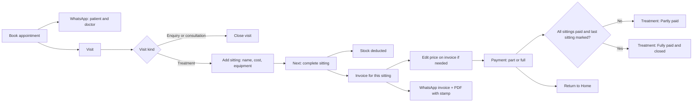
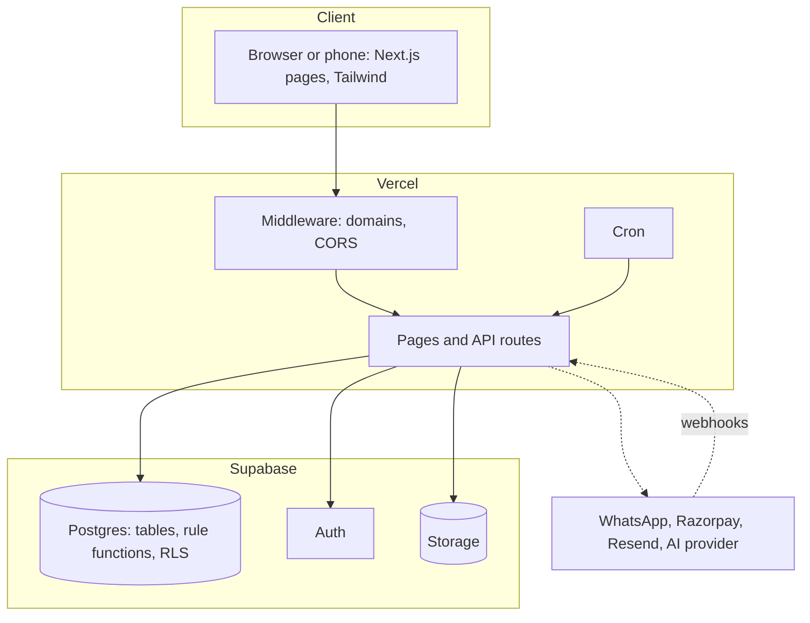

# Mediflow: functional and non-functional architecture

Status words: **Built** (in the product and tested), **Partial**, **Planned** (see `ROADMAP.md`). Numbers marked *target* are goals, not measurements; numbers marked *tested* are asserted by the test suite.

## Part A. Functional architecture

### A1. Actors and what each can do
| Actor | Can |
|---|---|
| Admin | Everything in the clinic: setup, settings, staff, builder, deletes, supplier bills |
| Doctor | Appointments, patients, treatments and sittings, visit notes, own hours, offers |
| Nurse | Clinical help, sittings, stock, orders, visit notes |
| Receptionist | Bookings, patients, billing, payments, recall, purchasing orders |
| Intern | Read only; no money figures |
| Patient | Public page and booking, WhatsApp chat (book, move, cancel, balance, STOP/START), treatment explainers, invoice link |
| Platform owner | Deploys, runs migrations, owns Meta, Razorpay and email accounts, billing of clinics (planned) |

### A2. Capability map
| Capability | Status | LLD |
|---|---|---|
| Sign-up, login, roles, per-clinic isolation, own domain | Built | 01 |
| First-run Setup, Settings, branding, clinic stamp | Built | 02 |
| Patients, record pages, custom fields, list views, global search, dustbin delete | Built | 03 |
| Appointments: slot-checked booking, reschedule, status, calendar, availability, phone calendar link | Built | 04 |
| Online booking with confirmation fee (Razorpay) | Built | 04 |
| Treatments with one or many sittings, per-sitting cost, equipment, part payment, close when paid | Built | 05 |
| Enquiry / consultation / treatment visit types | Built | 05 |
| Billing: invoices, GST, payments, PDF with stamp, send by WhatsApp and email | Built | 06 |
| Automatic WhatsApp for booking, invoice, reminder | Partial: code complete; needs Meta account and templates (shared number) | 07 |
| WhatsApp per clinic number, usage billing, spam controls | Planned | ROADMAP |
| Recall, offers with consent, WhatsApp inbound chat | Built | 07 |
| Stock, purchasing, supplier bills, order reminders | Built | 08 |
| Staff, users, hours, attendance, leave | Built | 09 |
| AI assistant and privacy layer | Built | 10 |
| AI Builder, apps, flows, reports, pinned tabs | Built | 11 |
| Dashboard, analytics, tasks, visit notes, patient summary | Built | 12 |
| Import patients from another app (CSV, preview, undo) | Built (patients only) | 02 |
| Import of appointments, bills, treatments, stock | Planned | ROADMAP |
| Offline use | Planned | ROADMAP |
| Meta ads integration | Planned | ROADMAP |

### A3. Core business flow

### A4. Functional rules that must always hold
1. A record belongs to one clinic; no screen, API or WhatsApp message may read or change another clinic's record.
2. A sitting is billed for its own cost only; the treatment status follows the sittings' payments.
3. Stock never goes below zero and goes down when a sitting is completed.
4. A paid or part-paid invoice cannot be deleted, only cancelled.
5. Nobody is double-booked, or booked on leave, outside hours or in a break.
6. Marketing messages go only to patients who opted in; STOP is honoured immediately.
7. Every save shows a success message; every failure shows a readable reason.

## Part B. Non-functional architecture

### B1. Security
| Topic | Design | Status |
|---|---|---|
| Authentication | Supabase Auth; bearer token verified on every API call | Built |
| Authorisation | Role list per route plus re-check inside database functions | Built |
| Tenant isolation | `clinic_id` on every row; row-level security; tenant guard triggers; `tenant_isolation_audit()`; final security sweep in the master SQL | Built |
| Public endpoints | Rate-limited, no private data; booking confirm verifies payment signature | Built |
| Webhooks | WhatsApp and Razorpay signatures verified | Built |
| Secrets | Environment variables only; clinic payment secrets encrypted at rest; AI history AES-256-GCM | Built |
| Uploads | Type, size and magic-byte checks; SVG refused | Built |
| Input handling | UUID checks, parameterised database calls, readable validation errors | Built |
| Abuse and spam | Opt-out, consent, daily limits; per-clinic caps and auto-pause | Partial / Planned |
| Key rotation | Documented in `OWNER_STEPS.md` and `docs/SECURITY.md` | Process |

### B2. Privacy and compliance
Patient data stays in the clinic's rows; AI sends nothing externally by default and only de-identified text when the admin enables it; history retention is admin-set and deletable; consent recorded for offers with date and source. The clinic is responsible for lawful use (health data, advertising rules); formal certification is not claimed.

### B3. Performance
| Measure | Value | Basis |
|---|---|---|
| Page DOMContentLoaded / load / transferred size | under 2.5 s / 4 s / 900 KB | *tested* (`performance.spec.ts`) |
| Typing response | under 1.5 s | *tested* |
| Round trips | One database call per business action (`tx_*` functions) | Design |
| Indexes | Speed indexes on date and clinic keys (migration 031) | Built |
| Caching | Shell cached per browser tab; PDF cache 60 s | Built |
| Long calls | Invoice send allows 30 s; external calls use timeouts (5 to 10 s) | Built |

### B4. Scalability and availability
| Topic | Design |
|---|---|
| Compute | Stateless Vercel functions scale horizontally |
| Data | One Postgres (Supabase); tenant column partitions logically; upgrade by plan or read replicas when needed |
| Limits | In-memory limiter is per instance (best effort); database enforces real per-phone and per-user limits |
| Queues | Flow events and WhatsApp work run inline or on daily cron; a real queue is needed at high volume (*planned with usage billing*) |
| Availability | *Target* follows Vercel and Supabase plan SLAs; no custom failover |
| Backups | Supabase backups per plan; clinic exports not built |

### B5. Reliability and error handling
Transactions for every multi-step rule; idempotent migrations; messaging never blocks a booking; every error mapped to a readable message; error boundaries per screen; fallbacks (tap-to-send link when WhatsApp fails; invoice prints without logo or stamp if it cannot load).

### B6. Usability, accessibility and devices
Mobile-first with media queries; tap targets of at least 44 px; 16 px inputs; horizontal scroll inside tab bar and tables, never the page; roles and labels on controls; colour contrast enforced for brand colours; seven device sizes from 280 px to 1440 px *tested* on 25 screens.

### B7. Maintainability
TypeScript strict; one place per rule (database function); architecture tests; numbered additive migrations; documents in `docs/design`; CI runs types, lint, unit, database and build.

### B8. Observability
`/api/health`; Vercel logs; outcome tables for messages and automations (`appointment_notifications`, `offer_sends`, `recall_log`, `flow_runs`, `builder_audit`). Dashboards and alerting on error rates are not built.

### B9. Cost and limits
Hosting: Vercel and Supabase plans. Pay per use: WhatsApp (Meta charges per conversation or message category, check Meta's current pricing), Razorpay fees, email, optional AI calls. Usage metering per clinic is planned so costs can be billed.

### B10. Known gaps (honest list)
No offline mode; WhatsApp needs Meta setup before it sends by itself; no per-clinic WhatsApp numbers yet; spam controls partial; no clinic data export; no error-rate alerting; invoice items still written with `description`/`price` keys (readers accept both).

## Part C. Technology and deployment view

