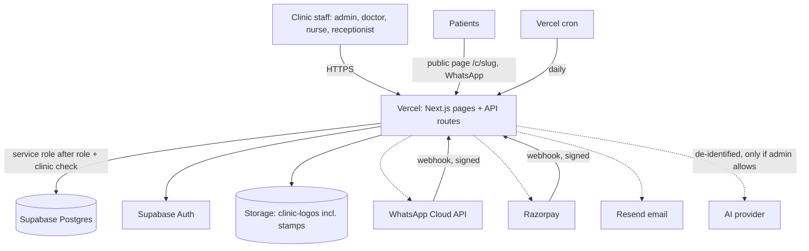
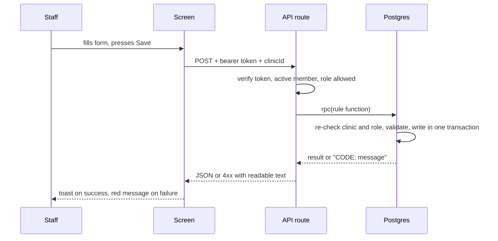

# Mediflow: high-level design

## 1. What it is
A multi-clinic practice-management SaaS, built first for dental clinics. One deployment serves many clinics. Staff sign in by role (admin, doctor, nurse, receptionist, intern); patients use a public booking page and WhatsApp. Stack: Next.js 14 (App Router, TypeScript, Tailwind) on Vercel, Supabase (Postgres, Auth, Storage), optional WhatsApp Cloud API, Razorpay, Resend email and an AI provider.

## 2. Context

## 3. Layers
| Layer | Where | Responsibility |
|---|---|---|
| Screens | `src/app/**/page.tsx`, `src/components` | Show data, collect input, show every error and success message |
| API routes | `src/app/api/**/route.ts` | Check the signed-in user, their clinic and role; validate input; call database rules; return JSON |
| Server libraries | `src/lib/server`, `src/lib/booking`, `src/lib/*` | Shared logic: errors, auth, PDF, notifications, engines |
| Database rules | `supabase/migrations/*.sql` | Transactions, validation and security (`tx_*`, `appt_*`, `bill_*` …); triggers keep totals in step |
| Tests | `tests/unit`, `tests/e2e`, `supabase/tests` | See LLD-14 |

Four rules guarded by tests (`tests/unit/architecture.test.ts`): every API route checks auth or is on the public list; every table carries `clinic_id`; rules run in the database; errors are readable.

## 4. Modules
| # | Module | Purpose | Main tables | LLD |
|---|---|---|---|---|
| 1 | Platform | Accounts, clinics, roles, tenancy, errors, domains | clinics, clinic_staff | 01 |
| 2 | Setup and Settings | First-run guide, clinic details, branding, stamp, AI privacy | clinics (settings json) | 02 |
| 3 | Patients and records | Patient record, custom fields, deletion, list views, search | clinic_patients, list_views, custom_field_defs | 03 |
| 4 | Appointments and booking | Slot-checked booking, calendar, online booking with fee | appointments, booking_holds, booking_payments | 04 |
| 5 | Treatments and sittings | Treatments with one or many sittings, own cost, equipment, part payment | treatment_plans, treatment_sittings, invoice_sittings | 05 |
| 6 | Billing | Invoices, payments, PDF with stamp, WhatsApp/email send | invoices, doc_counters | 06 |
| 7 | Messaging | WhatsApp and email, reminders, recall, offers with consent | appointment_notifications, wa_*, recall_log, offer_sends | 07 |
| 8 | Stock and purchasing | Stock, suppliers, orders, bills | stock_items, stock_movements, purchase_*, supplier_* | 08 |
| 9 | Team | Staff, users, hours, attendance, leave | doctors, doctor_schedules, attendance, staff_leaves | 09 |
| 10 | AI assistant | Chat to book and ask; privacy layer | ai_questionnaire, ai_memory | 10 |
| 11 | Builder, apps, flows | Admin builds tables, apps, reports, automations by chat | builder_*, flows, saved_* | 11 |
| 12 | Dashboard and clinical | Owner dashboard, analytics, tasks, visit notes | visit_notes, clinic_tasks | 12 |
| 13 | UI shell | Top tabs, menu, list engine, devices | n/a | 13 |

## 5. Main flows

**Visit to bill (the core clinic loop):** book appointment → (WhatsApp to patient and doctor) → visit: choose Enquiry, Consultation or Treatment → add a sitting with its cost and equipment → Next completes the sitting, deducts stock, creates the invoice for that sitting only → price can be edited on the invoice → payment recorded → treatment turns Partly paid, then Fully paid and closed when every sitting is paid and the doctor marks the last sitting → return to Home.

## 6. Data and security
| Concern | Design |
|---|---|
| Isolation | Every row has `clinic_id`; the API checks membership and role; rule functions re-check; tenant guard triggers on custom tables; `tenant_isolation_audit()` |
| Roles | admin, doctor, nurse, receptionist, intern. Interns read only |
| Secrets | Vercel environment variables only; clinic payment secrets stored encrypted; never returned to screens |
| Public endpoints | `/api/public/*` rate-limited, no private data; webhooks verify signatures |
| Files | Logos and stamps: PNG/JPG/WebP up to 1 MB, magic-byte checked, SVG refused |
| AI | Off by default for external providers; text de-identified; admin controls retention |
| Deletion | Dustbin on each record page with confirmation; checked on the server by role and clinic; paid invoices cannot be deleted (cancel instead) |
| Database exposure | A final sweep in the master SQL turns on row-level security for every public table |

## 7. Scheduled jobs (Vercel cron, `vercel.json`)
| Path | Time (UTC) | Job |
|---|---|---|
| `/api/ai/purge` | 21:30 | Delete AI history older than each clinic's retention |
| `/api/flows/run` | 11:30 | Day-before reminders, morning flows, low-stock flows, pending events |

## 8. Deployment
GitHub `main` deploys to Vercel. Database changes are numbered files in `supabase/migrations`; the owner runs `supabase/RUN_ME_ALL_MIGRATIONS.sql` (safe to repeat), then `notify pgrst, 'reload schema';`. Health: `GET /api/health`. Environment variables are listed in `.env.example`; steps in `OWNER_STEPS.md` and `docs/HOSTING.md`.

## 9. Quality
`npm test` (unit), `next build`, Playwright mock suite (functional, negative, regression, device matrix), local-Postgres SQL tests (`scripts/test-db.sh`). See LLD-14.
