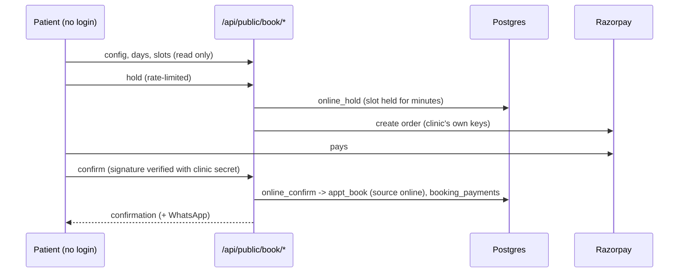

# LLD 04: Appointments and booking

## Purpose
Book a patient with a doctor at a free time, move or cancel it, show it on the calendar and let patients book online.

## Screens
`/appointments` (day list, `+ New` booking, Remind, Done, No-show, Reopen), `/appointments/[id]` (stepper Booked → Treatment → Bill, visit type badge, treatment step), `/appointments/list`, `/calendar`, `/availability`, public `/c/[slug]` and `/c/[slug]/book`.

## API
| Route | Method | Roles | Does |
|---|---|---|---|
| `/api/appointments/book` | POST | staff | `appt_book`: finds or creates the patient by phone, resolves the doctor, checks the slot, inserts; then notifies patient and doctor (`notify:false` skips) |
| `/api/appointments/slots` | GET | staff | Free times per doctor and a merged list for "auto-assign" |
| `/api/appointments/reschedule` | POST | staff | `appt_reschedule`, then notifies |
| `/api/appointments/status` | POST | staff | confirmed / cancelled / completed / no_show; only a cancellation is announced |
| `/api/appointments/notify` | POST | staff | Re-send confirmation or reminder |
| `/api/appointments/calendar` | GET | link with id | `.ics` so the patient's phone gets the appointment and reminders |
| `/api/doctors/availability` | GET, POST | admin all; doctor own | Weekly hours, breaks, slot length |

## Database rules
`appt_check_slot` refuses double booking, leave days, times outside hours and breaks (error `SLOT_UNAVAILABLE` with suggested times); `appt_slots` lists free times; `appt_resolve_doctor`, `appt_name_match`, `appt_norm_phone`, `appt_parse_time`; `appt_set_status`, `appt_set_times`, `appt_set_schedule`; `appt_clinic_tz` (per-clinic time zone); `set_appt_no` gives `APT-00001` numbers (migration 029); `refresh_appointment_billing` and trigger `trg_invoice_billing` keep `appointments.billing_status` in step with invoices; `trg_sitting_to_appointment` / `trg_sitting_visit_kind` keep the visit type (`appointments.visit_kind`: enquiry, consultation, treatment).

## Visit kinds
An appointment can be an enquiry or consultation with no treatment, or a treatment visit with a sitting attached (LLD-05). Nothing forces a treatment.

## Remind button
`remind` posts `{kind:"reminder"}` to `/api/appointments/notify`; the server sends WhatsApp to the patient and the doctor when WhatsApp is connected, otherwise returns a tap-to-send link (LLD-07).

## Online booking (migration 016, `src/lib/booking/online.ts`)

`razorpay/webhook` (signature-checked) covers payments completed outside the browser; `online_note_refund` marks a payment refunded after the gateway refund succeeds or fails.

## Errors the user sees
"That time is not free" with alternatives; "doctor on leave"; "no phone number"; network errors inline.

## Tests
Unit `doctor-parse.test.ts`, `online-booking.test.ts`; SQL `online_booking_test.sql`, `tenant_and_treatments_test.sql`; Playwright `smoke`, `features`, mock `devices`.
