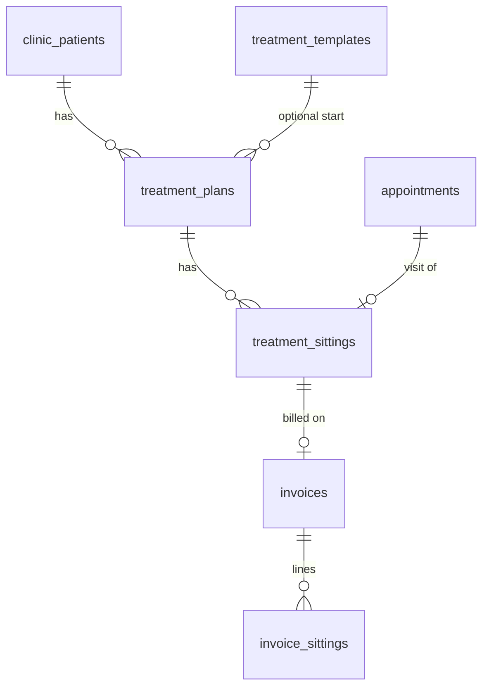

# LLD 05: Treatments and sittings

## Purpose
A treatment belongs to a patient and can have one sitting or many. Each sitting has its own name, cost and equipment, is billed alone, and can be paid in part. The treatment is partly paid until every sitting is paid, then fully paid and closed.

## Model

| Table | Key columns |
|---|---|
| `treatment_plans` | title, `total_amount` (estimate for flexible plans), discount, `status` active / completed / cancelled, `mode` (template or flexible), `payment_status` unpaid / part_paid / paid, `finish_requested`, `closed_at`, `clinic_patient_id`, `appointment_id` |
| `treatment_sittings` | seq, label (name), `due_amount` (cost billed), `paid_amount`, `consumables` json (equipment used), status pending / done / missed / cancelled, `appointment_id`, `invoice_id` |
| `invoice_sittings` | which sittings an invoice bills and the amount of each (migration 025) |
| `appointments.visit_kind` | enquiry, consultation or treatment |
| `treatment_templates` | name, total, sittings json (label, gap, share, duration, consumables); the "library" |

## Database functions
| Function | Purpose |
|---|---|
| `tx_add_sitting(p jsonb)` | Validates name (2+ chars), price (0 or more), optional estimate; links patient and appointment; starts a flexible plan when no `plan_id`; builds consumables; inserts the sitting; reopens a closed plan |
| `tx_update_sitting(p jsonb)` | Rename, change price (only before it is billed) or equipment of a sitting that is not done |
| `tx_complete_sitting` | Marks done, creates the invoice for that sitting, deducts stock, completes the appointment |
| `tx_pay_sitting` | Records a part or full payment against the sitting's invoice |
| `tx_finish_plan(clinic, plan, finish)` | "This was the last sitting": the plan closes as soon as everything is paid; `finish=false` reopens |
| `tx_create_plan` | Template plan with all sittings booked at once (older flow, unchanged) |
| `visit_attach_treatment` | Older template-based "this visit is a sitting" (kept) |
| `plan_refresh(plan)` | Recomputes `payment_status` and closes the plan when finished and paid |
| Triggers | `trg_sitting_refresh_plan`, `trg_plan_refresh_self`, `trg_plan_close_guard` (blocks closing unless finished and paid), `trg_invoice_to_sitting` (single-sitting invoice: total → cost, paid → paid), `trg_sitting_invoice_link`, `trg_sitting_to_appointment`, `trg_sitting_visit_kind` |
Status basis for an open flexible plan is the larger of billed sittings and (estimate − discount). All functions are granted to `service_role` only and re-check clinic ownership.

## API (`/api/treatments/*`)
| Route | Roles | Does |
|---|---|---|
| `sitting` POST `action: add / update / finish` | admin, doctor, nurse | The three flexible-sitting functions |
| `complete` | admin, doctor, nurse | Completes a sitting and bills it |
| `pay` | admin, doctor, receptionist | Part payment on a sitting |
| `create` | admin, doctor, receptionist | Template plan with booked sittings |
| `link` | staff | Tie an appointment to a sitting (patient must match) or untie |
| `info` | admin, doctor | Treatment explainers (patient-facing pages `/t/[id]`) |
| `/api/invoices/sittings` | admin, doctor, receptionist | Sittings on an invoice |
| `/api/visits/treatment` | admin, doctor, nurse | Older attach-template flow |

## Screens
| Screen | Behaviour |
|---|---|
| Visit page, Treatment step (`TreatmentFromVisit`) | Choose Enquiry / Consultation / Treatment. Treatment shows `SittingForm`; after saving, shows the plan, badge, totals, sitting chips, editable name, cost and equipment, **Next: complete this sitting and bill it →**, **+ Add the next sitting**, **This was the last sitting / Reopen treatment** |
| `SittingForm` | Patient search (when not given), treatment (open plans or "+ Start a new treatment" with name and estimate, template names suggested), sitting name, cost, optional date, equipment picker. Inline errors; toast `Sitting N added to <title>` |
| `EquipmentPicker` | "+ Add equipment" opens a stock search; rows show icon, quantity, remove, low-stock warning |
| `/sittings` (top tab) | Shared list of all sittings (columns: Sitting, Patient, Date, Cost, Paid, Payment, Status, Invoice); `+ New` opens the sitting form (`?new=1&patient=&plan=`) |
| `/treatments` | Plan cards with badge, estimate / billed / paid, progress, sittings table, Mark complete, Record payment, **+ Add sitting**, finish/reopen; `+ New treatment plan`; library and templates tab |
| Invoice page (`InvoiceTreatments`) | Treatment, badge, estimate, billed and paid; note that editing a sitting's price on the invoice updates the sitting |
| `AppointmentTreatment` | Older template-plan block; hidden for flexible plans to avoid duplicates |
Helpers in `src/lib/treatments.ts`: `inr`, `planBadge`, `sittingPay`, `planTotals`.

## Rules in plain words
1. A sitting is billed for its own cost only. Paying today's ₹2,000 does not touch the rest of a ₹40,000 treatment.
2. The cost can change on the invoice; the sitting follows.
3. Equipment is saved with the sitting; stock goes down when the sitting is completed.
4. All sittings paid **and** last sitting marked → treatment "Fully paid · closed". Adding another sitting reopens it.
5. Treatment is optional on an appointment.

## Tests
SQL `supabase/tests/flexible_sittings_test.sql` (Abdul scenario, reopen, finish waits for payment, cross-clinic refusals, legacy flow); Playwright `sittings.spec.ts` (add with equipment, missing name/cost, server error, badge and Add sitting, finish).
