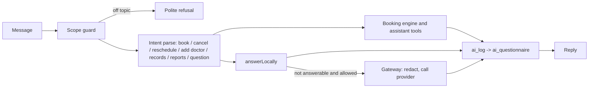

# LLD 10: AI assistant and trust layer

## Purpose
A chat that lets staff book, cancel, move and ask about the clinic in plain words, with privacy controls the admin owns. The AI Assistant button is at the bottom right of every page.

## Screens and API
`/chatbot` and `AssistantWidget`; `POST /api/chatbot`; `/api/ai/history` (GET mine, `?all=1` for admin; DELETE), `/api/ai/settings` (admin), `/api/ai/purge` (daily cron, `CRON_SECRET`).

## Flow

A half-finished request (a booking missing the time) is carried as a `draft`; open requests continue with `ax:` intents; every change asks "yes" first.

## Code
| File | Role |
|---|---|
| `lib/assistant/{index,calendar,records,reports,common}.ts` | Tools: agenda, free times, leave, hours, book/cancel/move/done, add/update/list records (saved as the caller), reports and dashboards |
| `lib/ai/scope.ts` | Allowed-topic guard |
| `lib/ai/redact.ts` | Strips names, phones, emails before any external call |
| `lib/ai/gateway.ts` | The only place an external model is called; only if the clinic enabled it |
| `lib/ai/crypto.ts`, `store.ts` | Encrypted history (AES, key from environment) |
| `lib/ai/memory.ts`, `ai_memory` | Learned preferences and shortcuts, shown to the user and deletable |
| `lib/ai/local-answers.ts` | Rule-based answers with no AI call |
Database: `ai_policy`, `ai_set_policy`, `ai_rate_check` (per-user rate limit), `ai_log`, `ai_delete`, `ai_purge`.

## Privacy defaults
External AI off; history kept for admin-set days (0 keeps nothing); admin can delete all stored questions; nothing identifiable leaves the system when enabled.

## Tests
Unit `assistant.test.ts`, `scope.test.ts`, `ai-memory.test.ts`; SQL `ai_trust_test.sql`, `agent_tools_test.sql`; Playwright mock `settings.spec.ts` (AI privacy card), `shell.spec.ts` (assistant button position).
