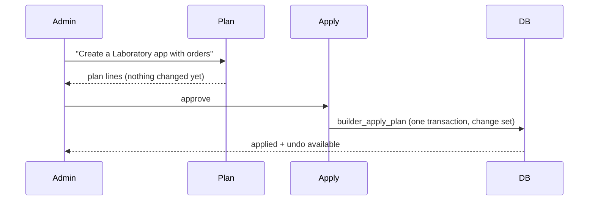

# LLD 11: AI Builder, apps and tabs, flows, reports

## Purpose
Let an admin shape the system by describing it: new tables and fields, apps and tabs, permission sets, reports and automations, with approval and undo. Also pin a screen as a main tab ("show stock in the main tabs").

## Screens and API
`/builder` (chat), `/builder/data`, `/builder/access`, `/builder/reports`, `/builder/flows`, `/apps/manage`, `/apps/[app]`, `/lists/[entity]`.
| Route | Role | Does |
|---|---|---|
| `/api/builder/plan` | admin | Scope guard, planner (rules, or the AI gateway only if allowed); returns plan lines, changes nothing |
| `/api/builder/apply` | admin | Re-validates the plan against the live schema (it may be stale or tampered), then `builder_apply_plan` in one transaction; records a change set |
| `/api/builder/rollback` | admin | `builder_rollback`; data-holding things are archived or hidden, never dropped |
| `/api/builder/schema`, `/data`, `/access`, `/reports` | by access | Schema, records, permission sets, saved reports and dashboards |
| `/api/apps`, `/api/apps/home` | member | Apps and tabs this person may see; app home numbers |
| `/api/flows`, `/flows/process`, `/flows/run` | admin / member / cron | Flow list (read only), run queued events, daily scheduled flows |
| `/api/custom-fields` | staff | Values of builder-added fields on built-in records |

## Plan, approve, undo

Internal helpers: `builder_create_object_internal`, `builder_add_field_internal`, `builder_hide_field_internal`, `builder_create_app_internal`, `builder_add_tab_internal`, `builder_configure_app_internal`, `builder_create_permission_set_internal`, `builder_create_report_internal`, `builder_create_dashboard_internal`, `builder_create_flow_internal`, `builder_set_flow_active_internal`, `builder_set_booking_rule_internal`. Names are validated (`builder_check_name`); custom data lives in real tables made by `tenant_data` with tenant-guard triggers; `builder_audit`, `builder_changesets`, `builder_unhandled` record what happened and what could not be done.

## Access
Admin sees everything. Others see custom objects only through permission sets (read/create/edit/delete, all records or own). `apps_for_user` and `app_visible` filter apps and tabs by role and permission set. Reports run through `builder_query`, which applies the same access.

## Pinned tabs (`src/lib/builder/pins.ts`)
Words such as "stocks" or "the calendar" resolve to a screen with its `New` and `List view` targets; pinned screens join the top tab bar. Built-in tabs are Home, Patients, Appointments, Treatments, Sittings, Billing.

## Flows (`src/lib/flows/engine.ts`, migration 008/013)
Trigger → action. Triggers: appointment booked, cancelled, completed, no-show; invoice paid; record saved; stock low; day before; daily. Actions: WhatsApp message or task. Database triggers (`flow_appt_trigger`, `flow_invoice_trigger`) enqueue `flow_events` only when an active flow exists; `flow_claim` locks events so none runs twice; `flow_runs` logs results; the screens call `/api/flows/process` right after a change; daily cron handles scheduled ones with per-day de-duplication.

## Tests
Unit `builder-agent.test.ts`, `builder-fields.test.ts`, `pin-tabs.test.ts`; SQL `builder_access_test.sql`, `app_manager_test.sql`.
